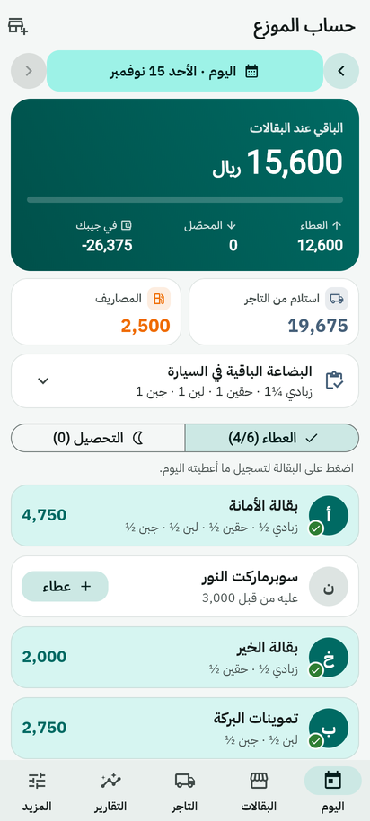
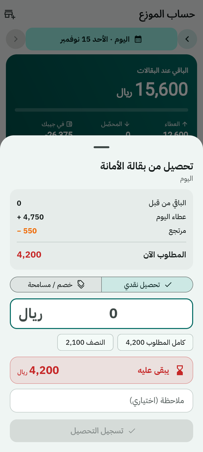
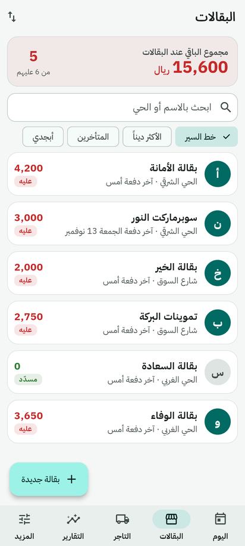
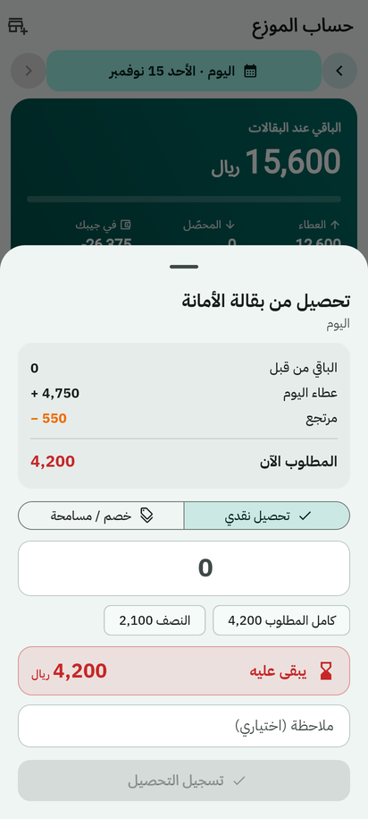

# حساب الموزع — Hisab Al-Mozaw3

**تطبيق أندرويد لموزّعي الألبان (زبادي، حقين، لبن…)**: يسجّل عطاء الصباح لكل بقالة، ويعرض ليلاً كم باقي عند كل صاحب بقالة، ويتابع حساب التاجر يوماً بيوم.

> بدون إنترنت · بدون حساب · كل البيانات على الجوال مع نسخ احتياطي تلقائي مثل واتساب.

<p align="center">
  
  
  
  
</p>

---


## الإصدار 2.2.0 — الجديد
- قائمة جانبية منظمة + زر ⚙ للإعدادات (حُذف «المزيد»).
- إضافة صنف جديد بشاشة كاملة + **باركود بكاميرا الجوال**.
- **ترخيص وتحديث عن بعد** عبر [hisab-almozaw3-dist](https://github.com/moain2028/hisab-almozaw3-dist) — الكود السري ومفتاح التوقيع في مستودع خاص.
- تدقيق واجهة آلي (0 تجاوز حدود على 6 مقاسات) — [التقرير](docs/design/ui-audit-2.2.0.md).
- تحليل ذاكرة وحجم مقاس — [التقرير](docs/design/memory-apk-2.2.0.md).

### تنزيل
| الجوال | الملف |
|---|---|
| معظم الجوالات الحديثة | [arm64 (26.6MB)](https://github.com/moain2028/hisab-almozaw3-dist/releases/download/v2.2.0/hisab-almozaw3-2.2.0-arm64.apk) |
| الجوالات القديمة | [armv7 (22.6MB)](https://github.com/moain2028/hisab-almozaw3-dist/releases/download/v2.2.0/hisab-almozaw3-2.2.0-armv7.apk) |

### المنظومة (3 مستودعات)
| المستودع | الرؤية | المحتوى |
|---|---|---|
| hisab-almozaw3 | عام | الكود + التوثيق |
| hisab-almozaw3-dist | عام | license.json (هاش فقط) + update.json + APK |
| hisab-almozaw3-secrets | **خاص** | مفتاح التوقيع + كود الترخيص |

## المشكلة التي يحلها

| الوقت | ما يحدث | ما يسجله التطبيق |
|---|---|---|
| ☀️ الصباح | يأخذ بضاعة من التاجر بالآجل | **استلام** (يزيد ما عليه للتاجر) |
| ☀️ الصباح | يوزّع على البقالات | **عطاء** لكل بقالة بأزرار ¼ ½ 1 |
| 🌙 الليل | يمر على البقالات ويتحصّل | **تحصيل** ← يظهر فوراً **الباقي عند البقالة** |
| ☀️ الصباح التالي | يحاسب التاجر | **دفعة للتاجر** |

**القاعدة المحاسبية (واضحة لأي شخص):**

```
الباقي على البقالة = دين سابق + العطاء − المرتجع − الخصم − التحصيل
ما عليك للتاجر    = رصيد سابق + الاستلام − الإرجاع − الدفعات
صافي الربح         = (المبيعات − المرتجعات − الخصومات) − تكلفة البضاعة − المصاريف
```

## الميزات

- **شاشة اليوم**: وضع العطاء (صباحاً) ووضع التحصيل (ليلاً، يتفعّل تلقائياً بعد العصر)، بترتيب خط السير.
- **إدخال سريع**: أزرار `+¼ +½ +1` مع تراجع ذكي، أو كتابة الكمية، وسعر خاص لعملية واحدة.
- **نافذة التحصيل**: `السابق + عطاء اليوم − المرتجع = المطلوب`، ثم يظهر الباقي لحظياً أثناء الكتابة.
- **المرتجعات والخصومات**: للبضاعة التالفة أو المنتهية.
- **البضاعة في السيارة**: ما استُلم مقابل ما وُزّع، مع تنبيه لو وُزّع أكثر مما استُلم.
- **كشف حساب** لكل بقالة وللتاجر مع الرصيد الجاري، وإرساله لصاحب البقالة على **واتساب**.
- **البقالات**: ترتيب حسب الدين أو المتأخرين في الدفع، وأرشفة.
- **التقارير**: صافي الربح، حركة النقد، المبيعات اليومية، ربح كل صنف، المصاريف حسب النوع.
- **نسخ احتياطي تلقائي محلي** في `Android/media/<package>/Backups` مع التحقق من سلامة الملف ← [التفاصيل](docs/design/backup.md).
- **تراجع** بعد أي حذف، وتنبيه عند الخروج بدون حفظ، واهتزاز خفيف، ووضع ليلي، وثلاثة أحجام للخط.

## الأداء (مقاس، وليس تقديراً)

| السيناريو | قبل (مسح كامل) | بعد (فهرس + كاش) |
|---|---|---|
| رسم شاشة اليوم لـ 40 بقالة، ~44 ألف حركة (سنتان) | **91 ms** لكل إطار | **0.064 ms** لكل إطار |
| بناء الفهرس (مرة واحدة عند التغيير) | — | 30 ms |

المصدر: `test/ledger_index_test.dart`. ميزانية الإطار عند 60fps هي 16.6ms. التفاصيل في [docs/design/performance.md](docs/design/performance.md).

## التشغيل

المتطلبات: **Flutter 3.35.x / Dart 3.9.x**، و Android SDK 35، و JDK 17.

```bash
flutter pub get
flutter analyze            # يجب أن يطبع: No issues found
flutter test               # 20 اختباراً
flutter run                # على جهاز أو محاكي
flutter build apk --release
# الناتج: build/app/outputs/flutter-apk/app-release.apk
```

معاينة الويب (للعرض فقط، تُحمّل بيانات تجريبية تلقائياً): `flutter build web --release`.

## هيكل المشروع

```
lib/
├── main.dart                  # الإقلاع، دورة الحياة، التنقل السفلي (بناء كسول للتبويبات)
├── core/format.dart           # تنسيق المال/الكميات/التواريخ، الأرقام العربية
├── models/models.dart         # Shop, Product, Trader, ShopTx, TraderTx, Expense
├── data/
│   ├── ledger.dart            # المحاسبة الصافية (مرجع الاختبارات)
│   ├── ledger_index.dart      # فهرس الحسابات: prefix sums + بحث ثنائي
│   ├── store.dart             # المخزن: Hive + فهارس تزايدية + كاش مُبطَل انتقائياً
│   ├── backup_service.dart    # النسخ الاحتياطي المحلي (GZip + SHA-256 + كتابة ذرية)
│   └── demo_data.dart         # بيانات مبدئية وتجريبية
├── ui/                        # الثيم والمكونات المشتركة
└── screens/                   # الشاشات
test/                          # وحدات + تكامل (Hive حقيقي) + أداء
docs/                          # التصميم، القرارات (ADR)، المتطلبات، أدلة التشغيل
```

## التوثيق

| الملف | المحتوى |
|---|---|
| [STATUS.md](STATUS.md) | الحالة الآن وخارطة الطريق |
| [docs/design/architecture.md](docs/design/architecture.md) | المعمارية وتدفق البيانات |
| [docs/design/performance.md](docs/design/performance.md) | الأداء والذاكرة والكاش |
| [docs/design/backup.md](docs/design/backup.md) | النسخ الاحتياطي والاسترجاع |
| [docs/design/ux-review.md](docs/design/ux-review.md) | مراجعة الواجهة وتجربة الاستخدام |
| [docs/adr/](docs/adr/) | سجل القرارات المعمارية |
| [docs/runbooks/](docs/runbooks/) | الإصدار، واسترجاع البيانات |
| [CHANGELOG.md](CHANGELOG.md) · [LESSONS.md](LESSONS.md) · [CONTRIBUTING.md](CONTRIBUTING.md) · [SECURITY.md](SECURITY.md) | |

## الترخيص

All rights reserved. © 2026. الخط: IBM Plex Sans Arabic بترخيص SIL OFL 1.1 (`assets/fonts/OFL.txt`).
